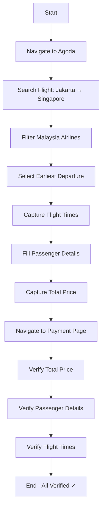

# Agoda Flight Booking E2E Test Automation

[](https://www.cypress.io/)
[](#)
[]()

## 📋 Overview

This project contains an End-to-End (E2E) automated test suite for Agoda.com flight booking flow using **Cypress** framework with **Page Object Model (POM)** design pattern. The test includes automated HTML reporting, video recording, and CI/CD integration.

## 🎯 Test Scenario

The test automates the following flight booking flow:

### 1. Flight Search
- Navigate to Agoda Flight booking page
- Set departure: **Jakarta**
- Set arrival: **Singapore**
- Set departure date: **Tomorrow** (dynamically calculated)
- Search flights

### 2. Flight Selection
- Filter or select **Malaysia Airlines**
- Sort/pick the **earliest departure time**
- **Capture & Store**: Departure time and Arrival time

### 3. Passenger Details
- Fill required passenger information with dummy data
- **Capture & Store**: Passenger details and Total Price

### 4. Payment Page Verification (⚠️ DO NOT PAY)
- Navigate to Payment page
- **Verify**:
  - ✓ Total Price matches Passenger Detail page
  - ✓ Passenger Details match entered inputs
  - ✓ Departure Time and Arrival Time match selected flight

## 📁 Project Structure

```
.
├── .github/
│   └── workflows/
│       └── e2e.yml                          # GitHub Actions CI/CD workflow
├── cypress/
│   ├── e2e/
│   │   └── agoda-flight-booking.cy.js      # Main E2E test spec
│   ├── pages/                               # Page Object Model classes
│   │   ├── FlightSearchPage.js             # Flight search page POM
│   │   ├── FlightResultsPage.js            # Flight results page POM
│   │   ├── PassengerDetailsPage.js         # Passenger details page POM
│   │   └── PaymentPage.js                  # Payment page POM
│   ├── support/
│   │   ├── commands.js                      # Custom Cypress commands
│   │   └── e2e.js                           # Global configuration
│   ├── reports/                             # HTML reports (auto-generated)
│   ├── screenshots/                         # Screenshots on failure
│   └── videos/                              # Video recordings
├── cypress.config.js                        # Cypress configuration
├── cypress.env.json                         # Environment variables
├── package.json                             # Project dependencies
├── .gitignore                              # Git ignore rules
└── README.md                                # This file
```

## 🚀 Installation & Setup

### Prerequisites

- **Node.js** (v14 or higher)
- **npm** or **yarn**
- **Git** (for CI/CD integration)

### Step 1: Clone the Repository

```bash
git clone <repository-url>
cd <project-directory>
```

### Step 2: Install Dependencies

```bash
npm install
```

This will install:
- Cypress v13.6.0
- cypress-mochawesome-reporter
- mochawesome report generator
- All required dependencies

### Step 3: Verify Installation

```bash
npx cypress verify
```

## ⚙️ Configuration

### Environment Variables (`cypress.env.json`)

```json
{
  "baseUrl": "https://www.agoda.com",
  "viewport": {
    "width": 1920,
    "height": 1080
  },
  "timeouts": {
    "defaultCommandTimeout": 15000,
    "pageLoadTimeout": 60000
  },
  "testData": {
    "origin": "Jakarta",
    "destination": "Singapore",
    "airline": "Malaysia Airlines"
  },
  "enableVideoRecording": true,
  "enableScreenshots": true
}
```

### Cypress Configuration (`cypress.config.js`)

- **Base URL**: Configurable via environment variables
- **Viewport**: 1920x1080
- **Video Recording**: Enabled (`video: true`)
- **HTML Reporter**: cypress-mochawesome-reporter
- **Retry**: 2 attempts in run mode
- **Screenshots**: Enabled on failure

## 🏃 Running the Tests

### Option 1: Interactive Mode (Cypress Test Runner)

```bash
npm run cy:open
```

This opens the Cypress Test Runner where you can:
- Select the test file to run
- Watch tests execute in real-time
- Debug failures interactively
- Time travel through test steps

### Option 2: Headless Mode (Command Line)

```bash
# Run all tests
npm test

# Run with Chrome browser
npm run test:chrome

# Run in headed mode (visible browser)
npm run test:headed

# Run with HTML report generation
npm run test:report
```

### Option 3: CI/CD Mode

```bash
# Run tests as in CI/CD pipeline
npm run ci:test
```

## 📊 HTML Reports & Video Recordings

### Accessing HTML Reports

**After running tests**, HTML reports are automatically generated:

```bash
# Run tests and generate report
npm run test:report
```

**View the report:**

1. Navigate to: `cypress/reports/html/`
2. Open `index.html` in your browser
3. The report includes:
   - Test execution summary
   - Pass/fail statistics
   - Execution time
   - Screenshots (on failure)
   - Stack traces
   - Charts and graphs

**Direct access:**
```bash
# Open HTML report in default browser (Mac/Linux)
open cypress/reports/html/index.html

# Windows
start cypress/reports/html/index.html

# Linux
xdg-open cypress/reports/html/index.html
```

### Video Recordings

**Location:** `cypress/videos/`

Videos are automatically recorded for every test run:

```
cypress/videos/
└── agoda-flight-booking.cy.js.mp4
```

**Features:**
- Full test execution recording
- Compressed (32 quality)
- MP4 format
- Includes all interactions
- Useful for debugging failures

**To view:**
```bash
# Navigate to videos folder
cd cypress/videos

# Open video
open agoda-flight-booking.cy.js.mp4
```

### Screenshots (on Failure)

**Location:** `cypress/screenshots/`

Screenshots are automatically captured when tests fail:

```
cypress/screenshots/
└── agoda-flight-booking.cy.js/
    └── test-name -- failed.png
```

### Cleaning Reports & Artifacts

```bash
# Remove all reports, screenshots, and videos
npm run clean:reports
```

## 🔄 CI/CD Integration (GitHub Actions)

### Workflow File: `.github/workflows/e2e.yml`

The project includes a complete GitHub Actions workflow that:

- ✅ Runs on push to `main`, `master`, or `develop` branches
- ✅ Runs on pull requests
- ✅ Runs on manual trigger
- ✅ Runs on schedule (daily at 2 AM UTC)
- ✅ Tests on multiple browsers (Chrome, Firefox, Edge)
- ✅ Generates HTML reports
- ✅ Uploads artifacts (reports, screenshots, videos)
- ✅ Retains artifacts for 30 days

### Triggering CI/CD

**Automatic triggers:**
```bash
# Push to main branch
git push origin main

# Create pull request
git checkout -b feature/new-test
git push origin feature/new-test
# Create PR on GitHub
```

**Manual trigger:**
1. Go to GitHub repository
2. Click "Actions" tab
3. Select "Agoda E2E Tests" workflow
4. Click "Run workflow"

### Viewing CI/CD Results

1. Go to repository → **Actions** tab
2. Click on the workflow run
3. View test results in summary
4. Download artifacts:
   - `cypress-results-chrome`
   - `cypress-results-firefox`
   - `cypress-results-edge`
   - `html-report-chrome`
   - `html-report-firefox`
   - `html-report-edge`

### CI/CD Environment Variables

Set these in GitHub repository settings:

- **Settings** → **Secrets and variables** → **Actions**
- Add secret: `CYPRESS_BASE_URL` (optional, defaults to Agoda)

## 🎨 Page Object Model (POM) Architecture

### Design Pattern Benefits

✅ **Separation of Concerns**: Page interactions separated from test logic  
✅ **Reusability**: Page methods can be reused across multiple tests  
✅ **Maintainability**: Easy to update when UI changes  
✅ **Readability**: Tests are more readable and descriptive  
✅ **Scalability**: Easy to add new pages and tests  

### Page Object Classes

#### 1. FlightSearchPage
```javascript
class FlightSearchPage {
  visit()                             // Navigate to flights page
  setOrigin(origin)                  // Set departure location
  setDestination(destination)        // Set arrival location
  selectDepartureDate()              // Select tomorrow's date
  clickSearch()                      // Submit search
  searchFlight(origin, destination)  // Complete search flow
}
```

#### 2. FlightResultsPage
```javascript
class FlightResultsPage {
  waitForResults()                   // Wait for search results
  filterByAirline(airline)           // Filter by airline
  sortByEarliestDeparture()          // Sort by earliest time
  selectEarliestFlight(airline)      // Select and capture flight
  captureFlightDetails()             // Get stored flight data
}
```

#### 3. PassengerDetailsPage
```javascript
class PassengerDetailsPage {
  waitForPageLoad()                  // Wait for page load
  fillPassengerDetails()             // Fill all passenger info
  captureTotalPrice()                // Capture total price
  clickContinue()                    // Proceed to payment
}
```

#### 4. PaymentPage
```javascript
class PaymentPage {
  waitForPageLoad()                  // Wait for page load
  verifyTotalPrice()                 // Verify price matches
  verifyPassengerDetails()           // Verify passenger info
  verifyFlightTimes()                // Verify flight times
  verifyPaymentPageWithoutPaying()   // Run all verifications
}
```

## 🛠️ Custom Cypress Commands

### General Purpose
- `cy.waitForElement(selector, timeout)` - Wait for element
- `cy.closePopupIfExists()` - Close popups/overlays
- `cy.getTomorrowDate()` - Get tomorrow's date
- `cy.safeFill(selector, value)` - Safe input filling
- `cy.clickWithRetry(selector, maxAttempts)` - Click with retry

## 📈 Test Execution Flow



## 📝 Test Data Management

### Using Environment Variables

```javascript
// In test file
const origin = Cypress.env('testData').origin;
const destination = Cypress.env('testData').destination;

// Or access directly
const baseUrl = Cypress.env('baseUrl');
```

### Modifying Test Data

Edit `cypress.env.json`:

```json
{
  "testData": {
    "origin": "Bangkok",
    "destination": "Tokyo",
    "airline": "ANA"
  }
}
```

## 🐛 Debugging & Troubleshooting

### Enable Debug Mode

```bash
# Run with debug output
DEBUG=cypress:* npm test
```

### Common Issues

#### Tests Failing?
1. Check selectors (Agoda may have changed DOM)
2. Increase timeouts in `cypress.env.json`
3. Run in headed mode to see what's happening
4. Check screenshots in `cypress/screenshots/`
5. Review video recordings in `cypress/videos/`

#### Reports Not Generating?
```bash
# Manually generate reports
npm run report:merge
npm run report:generate
```

#### Videos Not Recording?
Check `cypress.config.js`:
```javascript
video: true  // Must be true
```

## 📊 Performance Metrics

| Metric | Value |
|--------|-------|
| Average Test Duration | ~3-5 minutes |
| Video File Size | ~5-10 MB |
| Screenshot Size | ~100-500 KB |
| HTML Report Size | ~1-2 MB |

## 🔒 Best Practices Implemented

✅ Page Object Model (POM) design pattern  
✅ Environment-based configuration  
✅ Automated HTML reporting  
✅ Video recording for all tests  
✅ Screenshot capture on failure  
✅ CI/CD integration (GitHub Actions)  
✅ Multi-browser testing  
✅ Retry mechanism for flaky tests  
✅ Clean separation of concerns  
✅ Comprehensive documentation  

## 📚 Additional Resources

- [Cypress Documentation](https://docs.cypress.io/)
- [Page Object Model Pattern](https://martinfowler.com/bliki/PageObject.html)
- [Mochawesome Reporter](https://github.com/adamgruber/mochawesome)
- [GitHub Actions for Cypress](https://github.com/cypress-io/github-action)

## 🤝 Contributing

Feel free to submit issues or pull requests to improve this test suite.

## 📄 License

ISC

---

**Author**: Senior Software QA Automation Engineer  
**Framework**: Cypress v13.6.0  
**Design Pattern**: Page Object Model (POM)  
**Reporting**: cypress-mochawesome-reporter  
**CI/CD**: GitHub Actions  
**Last Updated**: 2026-10-08

---

## ⭐ Quick Start Commands

```bash
# Setup
npm install

# Run tests with report
npm run test:report

# View HTML report
open cypress/reports/html/index.html

# View videos
open cypress/videos/

# Clean artifacts
npm run clean:reports
```
